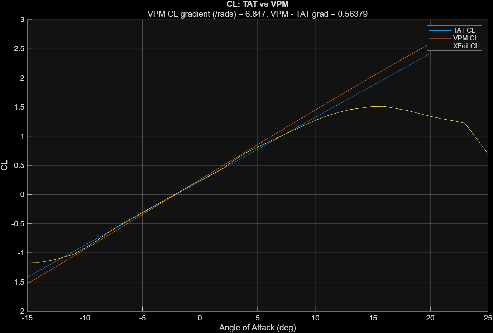

# Vortex Panel Method Evaluation

**An Independent Computational Aerodynamics Project | MATLAB**

This repository contains a MATLAB implementation of the two-dimensional Vortex Panel Method (VPM), together with numerical investigations into its convergence, numerical reliability, and aerodynamic predictions.

The project evaluates the numerical behaviour and limitations of VPM through systematic comparisons of panel discretisation, alternative lift-calculation methods, and established aerodynamic models such as Thin Airfoil Theory (TAT) and XFOIL.

The work is undertaken independently as a technical investigation into computational aerodynamics and numerical methods.

---

## 1. Project Objectives

The principal objectives are to:

1. Implement a two-dimensional linear-strength vortex panel method for NACA aerofoils.
2. Investigate numerical convergence as the number and distribution of panels are varied.
3. Examine the conditioning of the aerodynamic influence matrix and its implications for numerical reliability.
4. Compare three methods of calculating lift:
   - Kutta–Joukowski circulation
   - Surface pressure integration
   - Control-volume momentum conservation
5. Investigate the sensitivity of surface pressure predictions to pressure-sampling distance.
6. Compare aerodynamic predictions from VPM, Thin Airfoil Theory, and XFOIL.
7. Distinguish numerical discretisation errors from differences arising from the physical assumptions of aerodynamic models.

The accompanying technical report develops and evaluates these investigations.

---

## 2. Repository Structure

```text
Vortex Panel Method Evaluation/
│
├── README.md
│
├── compareTAT_VPM.m
├── errorPlot.m
├── errorPowerLaw.m
├── liftMethodComparison.m
├── plotCL_N.m
│
├── naca2412_polar.txt
├── Copy_of_naca2412_polar.txt
├── NACA2412_CL.png
│
├── Vortex Panel Method/
│   ├── generateAirfoil.m
│   ├── generateNaca4.m
│   ├── calcVSS.m
│   ├── intSF.m
│   │
│   ├── calcFreestream.m
│   ├── calcInducedFlow.m
│   ├── calcVelocityField.m
│   ├── calcPressure.m
│   ├── calcStreamline.m
│   │
│   ├── calcCL1.m
│   ├── calcCL2.m
│   ├── calcCL3.m
│   ├── calcCL_CM1.m
│   │
│   ├── plotAirfoil.m
│   ├── plotCL1.m
│   ├── plotCL_CM.m
│   ├── plotCpGraph.m
│   ├── plotFlowCartesian.m
│   ├── plotFlowRotated.m
│   ├── plotPressureField.m
│   │
│   ├── rotatePoint.m
│   ├── rotateMesh.m
│   ├── rotateAirfoil.m
│   │
│   ├── test.m
│   └── testVSS.m
│
└── Thin Airfoil Theory/
    └── [Separate TAT implementation]
```

The repository is divided into two principal components.

**`Vortex Panel Method/`** contains the numerical solver and supporting functions used to generate aerofoil geometries, determine vortex-sheet strengths, calculate aerodynamic quantities, and visualise the resulting flow.

The MATLAB scripts in the **main directory** conduct the numerical investigations supporting the technical report.

The **`Thin Airfoil Theory/`** directory contains a separate implementation used for comparison with VPM.

The structure assumes that uploaded files have been restored to their original MATLAB filenames without automatically appended suffixes such as `(1)` or `(2)`.

---

## 3. Mathematical Formulation

### 3.1 Governing Assumptions

The Vortex Panel Method models steady, two-dimensional, incompressible, inviscid, and irrotational flow outside the vortex-sheet singularities.

The velocity field can be expressed through a velocity potential:

$$
\mathbf{V}=\nabla\phi
$$

For incompressible, irrotational flow, the potential satisfies Laplace's equation:

$$
\nabla^2\phi=0
$$

The aerofoil boundary is represented by a vortex sheet whose strength varies along the surface.

The circulation around the aerofoil is determined by the vortex-sheet distribution, subject to the no-penetration boundary condition and the Kutta condition.

### 3.2 Panel Discretisation

The aerofoil boundary is divided into $N$ straight panels.

Each panel has:

- Two endpoint coordinates
- A panel-centre control point
- A panel length
- A tangential direction
- An outward normal direction

The vortex-sheet strength is assumed to vary linearly between consecutive panel endpoints.

For panel $j$:

$$
\gamma_j(s)=
\gamma_j+
\frac{\gamma_{j+1}-\gamma_j}{L_j}s
$$

where $L_j$ is the panel length and $0\leq s\leq L_j$.

The complete discretisation contains $N+1$ vortex-sheet-strength unknowns.

### 3.3 Boundary Conditions

The no-penetration condition requires:

$$
\mathbf{V}\cdot\mathbf{n}=0
$$

at every panel control point.

The velocity consists of the freestream and vortex-induced contributions:


$$\mathbf{V} = \mathbf{V}_{\infty} + \mathbf{V}_{\mathrm{induced}}$$


Enforcing no penetration at $N$ control points provides $N$ linear equations.

An additional equation is supplied by the trailing-edge Kutta condition.

For the vortex-strength and panel-orientation convention used in the implementation, the discrete Kutta condition is:

$$
\gamma_1+\gamma_{N+1}=0
$$

The resulting system is:

$$
\mathbf{M}\boldsymbol{\gamma}=\mathbf{b}
$$

where:

- $\mathbf{M}$ is the augmented aerodynamic influence matrix.
- $\boldsymbol{\gamma}$ contains the unknown endpoint vortex-sheet strengths.
- $\mathbf{b}$ contains the freestream normal-velocity contributions and the Kutta-condition constraint.

The system is assembled and solved in `calcVSS.m`.

### 3.4 Velocity and Pressure

Once the vortex-sheet strengths are known, the induced velocity field is calculated by summing the contributions of all panels.

The complete velocity field is:

$$
\mathbf{V}
=
\mathbf{V}_{\infty}
+
\sum_j\mathbf{V}_j
$$

The pressure coefficient is calculated using the incompressible Bernoulli relationship:

$$
C_p=1-\frac{|\mathbf{V}|^2}{U_\infty^2}
$$

The implementation uses a nondimensional freestream velocity of:

$$
U_\infty=1
$$

Therefore:

$$
C_p=1-(U^2+V^2)
$$

---

## 4. Lift Calculation Methods

Three methods are implemented to calculate the lift coefficient.

These methods provide complementary checks of the numerical solution, although they share the same underlying vortex-panel representation.

### 4.1 Method 1 — Surface Pressure Integration

**Function:** `calcCL1.m`

The pressure coefficient is evaluated at points displaced a small distance outside the panel centres.

The pressure force is approximated using midpoint integration over the panels.

The lift is obtained by resolving the resulting pressure forces perpendicular to the freestream.

The sampling distance is initially specified as:

```matlab
eps = 1e-5;
```

This method introduces numerical sensitivity associated with the pressure-sampling offset and surface-force integration.

The related function `calcCL_CM1.m` also calculates a pitching-moment coefficient.

### 4.2 Method 2 — Kutta–Joukowski Circulation

**Function:** `calcCL2.m`

The circulation is calculated by integrating the vortex-sheet strength along the entire aerofoil boundary.

For the piecewise-linear vortex-sheet distribution:

$$
\Gamma=
\sum_{j=1}^{N}
\frac{\gamma_j+\gamma_{j+1}}{2}L_j
$$

The trapezoidal expression is exact for each represented linear-strength panel.

The lift per unit span is obtained from the Kutta–Joukowski theorem:

$$
L'=\rho U_\infty\Gamma
$$

With unit chord and freestream velocity, the lift coefficient is:

$$
C_L=2\Gamma
$$

The code applies the circulation sign convention consistent with its panel orientation.

This is the principal lift-calculation method used in the investigation.

### 4.3 Method 3 — Control-Volume Momentum Conservation

**Function:** `calcCL3.m`

The third method applies the steady integral momentum equation to a rectangular control volume enclosing the aerofoil.

For steady, inviscid flow without additional body forces:

$$
\mathbf{F}_{\mathrm{airfoil}}
=
\mathbf{F}_{\mathrm{outer\ pressure}}
-
\mathbf{F}_{\mathrm{momentum\ flux}}
$$

The implementation evaluates:

- Pressure forces along the outer control surface
- Momentum flux through each control-volume boundary
- The resulting aerodynamic force on the aerofoil

The force is resolved perpendicular to the freestream to determine the lift coefficient.

Numerical integration is performed using MATLAB's `trapz` function.

The control-volume dimensions and grid spacing can be adjusted within `calcCL3.m`.

### 4.4 Comparing the Methods

The script `liftMethodComparison.m` compares the lift coefficients predicted by the three methods over a range of angles of attack.

Agreement between the methods provides evidence of internal consistency in the velocity, pressure, circulation, and force calculations.

However, agreement does not independently establish the physical accuracy of the aerodynamic model.

---

## 5. Numerical Investigations

The scripts in the main repository directory support the technical report.

### 5.1 Panel-Count Convergence

**Scripts:**

- `plotCL_N.m`
- `errorPlot.m`
- `errorPowerLaw.m`

The lift coefficient is evaluated over a range of panel counts.

The investigation examines whether the numerical solution approaches an asymptotic value as the number of panels increases.

A power-law model is used:

$$
C_L(N)=C_{L,\infty}+kN^{-p}
$$

where:

- $C_{L,\infty}$ is the extrapolated infinite-panel lift coefficient.
- $k$ is a fitted constant.
- $p$ is the observed convergence exponent.

Trial exponents are assessed using linear least-squares regression and the coefficient of determination, $R^2$.

Richardson-style estimates are also used to examine the observed convergence order.

For successive meshes with refinement ratio two:

$$
p=
\log_2\left|
\frac{C_L(N)-C_L(2N)}
{C_L(2N)-C_L(4N)}
\right|
$$

This expression assumes an asymptotic power-law error and geometrically refined meshes.

A high regression $R^2$ indicates goodness of fit over the tested data but does not by itself prove asymptotic convergence.

### 5.2 Uniform Versus Cosine Panel Spacing

The aerofoil generator supports two chordwise panel distributions:

- Uniform chordwise spacing
- Cosine spacing

The distribution is selected using the `cosDistribution` variable in `generateNaca4.m`.

For cosine spacing:

$$
x=\frac{1-\cos\theta}{2}
$$

with uniformly spaced values of $\theta$ between $0$ and $\pi$.

This concentrates smaller panels near the leading and trailing edges.

The investigation compares how the distribution affects the observed convergence of lift predictions.

### 5.3 Influence-Matrix Conditioning

The influence matrix is investigated as the number of panels and aerofoil geometry are varied.

The matrix condition number provides a measure of sensitivity to perturbations in the linear system.

Potential numerical difficulties include:

- Very small panels near the leading and trailing edges
- Close spacing between the upper and lower surfaces of thin aerofoils
- Near-linear dependence in the influence matrix
- Floating-point cancellation during influence-coefficient evaluation

The expression:

```matlab
C5 = sqrt(C4 - C3^2);
```

is one possible source of numerical sensitivity when the two terms being subtracted are nearly equal.

The precise causes of numerical failure require further investigation.

### 5.4 Pressure-Sampling Sensitivity

**Script:** `Vortex Panel Method/plotCpGraph.m`

The pressure coefficient is evaluated at different distances from the panel centres:

$$
\varepsilon=10^{-p}
$$

The investigation examines the sensitivity of the pressure distribution and pressure-derived lift coefficient to this offset.

A power-law model is fitted:

$$
C_L(\varepsilon)=C_{L,0}+k\varepsilon^q
$$

where $C_{L,0}$ represents the extrapolated zero-offset lift coefficient.

This investigation concerns pressure-evaluation sensitivity rather than panel-count convergence.

### 5.5 Comparison with Thin Airfoil Theory and XFOIL

**Script:** `compareTAT_VPM.m`

The project compares lift and pitching-moment predictions from:

1. Thin Airfoil Theory
2. The implemented Vortex Panel Method
3. XFOIL polar data

Thin Airfoil Theory provides an analytical approximation for thin aerofoils.

The VPM accounts for finite-thickness geometry while retaining inviscid potential-flow assumptions.

XFOIL combines an inviscid panel method with boundary-layer and wake modelling in viscous mode.

The comparison is intended to investigate how modelling assumptions and aerofoil geometry influence aerodynamic predictions.

XFOIL data are imported from text polar files rather than generated directly by MATLAB.

Comparisons with XFOIL are numerical model comparisons, not experimental validation.

### 5.6 Example: NACA 2412 Lift Comparison



The figure compares lift-coefficient predictions for NACA 2412.

Differences between methods may arise from their respective physical assumptions, geometric approximations, and numerical formulations.

---

## 6. MATLAB Function Reference

### 6.1 Geometry and Vortex-Sheet Solver

| File | Description |
|---|---|
| `generateAirfoil.m` | Generates an aerofoil structure containing panel geometry and associated properties. |
| `generateNaca4.m` | Generates NACA four-digit aerofoil coordinates using uniform or cosine spacing. |
| `calcVSS.m` | Assembles and solves the augmented influence-matrix system for vortex-sheet strengths. |
| `intSF.m` | Evaluates analytical influence-integral expressions used by the solver. |

### 6.2 Flow-Field Calculations

| File | Description |
|---|---|
| `calcFreestream.m` | Returns the nondimensional freestream velocity components. |
| `calcInducedFlow.m` | Calculates velocity induced by the vortex panels. |
| `calcVelocityField.m` | Combines freestream and induced velocities. |
| `calcPressure.m` | Calculates the pressure coefficient from the velocity field. |
| `calcStreamline.m` | Numerically traces streamlines through the calculated velocity field. |

### 6.3 Aerodynamic Coefficients

| File | Description |
|---|---|
| `calcCL1.m` | Calculates lift using surface pressure integration. |
| `calcCL2.m` | Calculates lift from circulation using Kutta–Joukowski. |
| `calcCL3.m` | Calculates lift using a control-volume momentum balance. |
| `calcCL_CM1.m` | Calculates lift and pitching-moment coefficients using pressure integration. |

### 6.4 Visualisation

| File | Description |
|---|---|
| `plotAirfoil.m` | Plots the aerofoil geometry and mean camber line. |
| `plotCL1.m` | Plots lift coefficient against angle of attack. |
| `plotCL_CM.m` | Generates lift and pitching-moment plots. |
| `plotCpGraph.m` | Plots surface pressure distributions and investigates sampling offsets. |
| `plotFlowCartesian.m` | Plots velocity vectors and streamlines in chord-aligned coordinates. |
| `plotFlowRotated.m` | Plots the flow field in freestream-aligned coordinates. |
| `plotPressureField.m` | Generates a coloured pressure-coefficient contour plot. |

### 6.5 Coordinate Transformations and Testing

| File | Description |
|---|---|
| `rotatePoint.m` | Rotates point coordinates. |
| `rotateMesh.m` | Rotates coordinate meshes. |
| `rotateAirfoil.m` | Rotates an aerofoil structure. |
| `test.m` | Development script for examining influence coefficients. |
| `testVSS.m` | Development test for the no-penetration condition. |

The test scripts are exploratory and should not be interpreted as a complete automated verification suite.

---

## 7. Installation and Usage

### 7.1 Requirements

- MATLAB
- Access to the repository files
- A MATLAB version supporting the functions used in the scripts

The core VPM uses standard MATLAB numerical operations.

Some optional development scripts use symbolic functions such as `syms` and `vpaintegral`, which require the Symbolic Math Toolbox.

The TAT comparison requires the separate Thin Airfoil Theory implementation.

### 7.2 Getting Started

Clone or download the repository and open MATLAB.

Set the current working directory to:

```text
Vortex Panel Method Evaluation
```

Add the solver folder to the MATLAB search path:

```matlab
addpath('Vortex Panel Method')
```

### 7.3 Generate an Aerofoil

```matlab
airfoil = generateAirfoil('2412', 200);

figure;
plot(airfoil.panelBoundary(:,1), ...
     airfoil.panelBoundary(:,2), 'k-');

axis equal;
grid on;

xlabel('x/c');
ylabel('y/c');
title('NACA 2412 Aerofoil');
```

The aerofoil structure contains the panel coordinates, centres, lengths, directions, and outward normals.

### 7.4 Calculate Vortex-Sheet Strengths

```matlab
airfoil = generateAirfoil('2412', 200);

AoA = deg2rad(5);

vss = calcVSS(airfoil, AoA);
```

Angles of attack are specified in radians.

### 7.5 Calculate Lift Using Circulation

```matlab
airfoil = generateAirfoil('2412', 200);

AoA = deg2rad(5);

CL = calcCL2(airfoil, AoA);

fprintf('CL = %.6f\n', CL);
```

### 7.6 Compare Lift-Calculation Methods

```matlab
airfoil = generateAirfoil('2412', 200);

AoA = deg2rad(5);

CL_pressure = calcCL1(airfoil, AoA);
CL_circulation = calcCL2(airfoil, AoA);
CL_momentum = calcCL3(airfoil, AoA);

fprintf('Pressure:    %.6f\n', CL_pressure);
fprintf('Circulation: %.6f\n', CL_circulation);
fprintf('Momentum:    %.6f\n', CL_momentum);
```

The three methods can be compared to investigate numerical consistency.

### 7.7 Generate Pressure and Velocity Plots

Run the scripts:

```matlab
plotPressureField
```

```matlab
plotFlowCartesian
```

```matlab
plotFlowRotated
```

The relevant aerofoil, angle of attack, mesh resolution, and plotting limits are specified near the beginning of each script.

### 7.8 Run the Numerical Investigations

From the main repository directory:

```matlab
liftMethodComparison
```

```matlab
errorPowerLaw
```

```matlab
plotCL_N
```

Some analysis scripts contain relative directory changes and may require path adjustments depending on the MATLAB working directory.

---

## 8. XFOIL Data

The repository includes XFOIL polar data for NACA 2412.

The supplied polar files identify:

- XFOIL version: 6.99
- Aerofoil: NACA 2412
- Reynolds number: 1,000,000
- Mach number: 0.1
- Critical amplification factor: $N_{\mathrm{crit}}=9$

The polar data include angle of attack, lift coefficient, drag coefficient, pitching-moment coefficient, and transition locations.

These results provide a reference for comparison with the implemented VPM and Thin Airfoil Theory.

Because the XFOIL data are generated using a different aerodynamic model, discrepancies may arise from viscous effects, compressibility corrections, transition modelling, and numerical implementation.

---

## 9. Known Limitations

### 9.1 Physical Modelling

The VPM assumes inviscid, incompressible potential flow.

Consequently, it does not directly predict:

- Viscous skin-friction drag
- Boundary-layer development
- Laminar-to-turbulent transition
- Viscous flow separation
- Stall
- Shock waves
- Three-dimensional induced drag

The results should not be interpreted as complete predictions of real viscous aerofoil behaviour.

### 9.2 Numerical Limitations

The solver may become sensitive to panel geometry and numerical precision at high panel counts.

The influence-integral calculations may suffer floating-point cancellation in nearly degenerate geometric configurations.

Surface pressure integration introduces additional sensitivity to the sampling offset.

The observed convergence order can depend on panel distribution, aerofoil geometry, and the aerodynamic quantity being evaluated.

### 9.3 Implementation Limitations

The current geometry generator supports NACA four-digit aerofoils.

Five-digit aerofoil generation is not implemented.

The `cosDistribution` setting is currently selected inside `generateNaca4.m`, rather than passed as a function argument.

Some investigation scripts depend on relative paths and separate implementations.

The current implementation is intended for technical investigation and numerical experimentation rather than production aerodynamic design.

---

## 10. Verification and Validation

An important objective of this project is to distinguish numerical verification from physical validation.

**Numerical verification** concerns whether the implementation correctly approximates the chosen governing equations and boundary conditions.

Relevant investigations include:

- Panel-count convergence
- No-penetration residuals
- Influence-matrix conditioning
- Consistency between circulation, pressure, and momentum-based lift calculations
- Comparison with analytical potential-flow solutions

**Physical validation** concerns whether the mathematical model accurately predicts experimentally observed aerodynamic behaviour.

Comparison with experimental wind-tunnel data would be required to support physical validation claims.

Agreement with XFOIL alone does not establish experimental validation.

---

## 11. Future Development

Potential extensions include:

- Additional analytical verification cases
- Improved numerical treatment of nearly singular influence integrals
- Systematic investigation of matrix conditioning
- Comparison of panel distributions across a wider range of aerofoil geometries
- Automated convergence studies
- Improved pressure evaluation directly at the exterior surface limit
- Expanded TAT–VPM–XFOIL comparisons
- Comparison with published experimental aerofoil measurements
- Improved code modularity and automated testing

These are potential extensions rather than completed features.

---

## 12. References

1. Houghton, E. L., Carpenter, P. W., Collicott, S. H. and Valentine, D. T. (2013). *Aerodynamics for Engineering Students*. 6th ed. Butterworth-Heinemann.

2. Drela, M. (1989). *XFOIL: An Analysis and Design System for Low Reynolds Number Airfoils*. Lecture Notes in Engineering, Vol. 54.

3. [XFOIL Formulation Documentation](https://v0xnihili.github.io/xfoil-docs/formulations/)

---

## Project Status

**Ongoing independent technical investigation.**

The vortex panel solver and several numerical investigations have been implemented.

Further comparisons with Thin Airfoil Theory and XFOIL, along with additional verification and refinement of the numerical methodology, remain in progress.

This repository documents the development, methodology, results, and limitations of the project.
